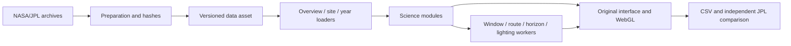

# Lunar Landing Site Navigator

**Live demo:** https://dima000000.github.io/NASA-lunar-navigator/
**Repository:** https://github.com/Dima000000/NASA-lunar-navigator
**Challenge:** https://www.spaceappschallenge.org/2026/challenges/lunar-landing-site-navigator/


> Not affiliated with or endorsed by NASA. NASA data are used under their public terms. Research and education; not operational landing or navigation certification.

## What it is for

**User:** lunar mission planners and student researchers exploring the lunar south pole.

**Decision:** where and when to stay on the surface to obtain sunlight and a geometric line of sight to Earth.

**Result:** compare locations and dates against measured LOLA horizons, inspect 3D terrain and find five high-scoring surface-stay windows of a year. A hypothetical rover demonstrates constraints from moving shadows, energy and terrain.

## Team — Dark Vector

Lunar Landing Site Navigator was developed by **Dark Vector**:

| Project author | Space Apps username |
|---|---|
| Andrey Stomma | @antchupick |
| Dmitry Belousov | @dimabel |
| Ivan Ermolaev | @ermolaevivan |
| Gleb Naumkin | @gnaum31415 |

[Team credits](AUTHORS.md) · [Dark Vector on NASA Space Apps](https://www.spaceappschallenge.org/2026/find-a-team/dark-vector/?tab=members)

## Key findings

All values below use a **2 m mast**, **hourly samples**, **7-day stays**, **6 h start grid**, Sun/Earth/short-night weights **50/30/20**. Visible means more than 0.05% of an apparent disc clears the sampled horizon.

- Connecting Ridge, Gläser spot 2: the highest-ranked 2027 stay is **9 January 12:00 UTC to 16 January 12:00 UTC**. Sun/Earth visibility: **100% / 100%** of 168 hourly samples; longest night **0 h**.
- At de Gerlache rim 2 · dGR201 in that **same week**, Sun/Earth visibility is **44.05% / 100%**, with **85 h** longest night. Its own highest-ranked stay, **17–24 January 2027, 00:00 UTC**, gives **100% / 100%** and **0 h** longest night. Choosing dates changes the comparison substantially.

These are model predictions, not future observations or guaranteed mission outcomes. [Numerical findings](public/research/findings-2027.csv), [Connecting Ridge browser export](public/research/findings-2027-export-cr.csv), [de Gerlache browser export](public/research/findings-2027-export-sdg.csv).

## Validation

| Check | Model / browser | Reference | Difference |
|---|---|---|---|
| Sun/Earth direction, 3 sites, 4,326 hourly comparisons | Actual CSV | JPL Horizons, 14 Nov–14 Dec 2026 | ≤0.0006°, requirement 0.1° |
| Connecting Ridge spot 2, 2 m, any Sun | 92.07% | Gläser et al., 92.3% | −0.23 pp |
| Connecting Ridge spot 4, 10 m, any Sun | 95.63% | Gläser et al., 95.66% | −0.03 pp |
| Shackleton published point 4, 10 m, Sun centre | 87.59% | Saha et al. 2023, 86.90% | +0.69 pp |
| Shackleton published point 8, 10 m, Sun centre | 86.67% | Saha et al. 2023, 86.18% | +0.49 pp |
| Shackleton published points, 2 m | Exact-coordinate comparisons | Gläser et al. | Up to 2.72 pp |

Annual predictions use 8,760 hours in 2026. Study periods, terrain releases and visibility definitions differ: consistency checks, not exact replications. [Sources, coordinates and scientific review](public/research/SCIENCE_REVIEW.md), [actual CSV vs JPL](public/research/browser-vs-horizons.csv).

## Loading and performance

Measured overview and interface load first; detailed default-site data follow in the background. Other site grids, LROC textures, route atlases and ephemeris years load on request. The full-detail globe loads automatically in the background right after the first frame. No procedural terrain replaces missing data.

**Initial load: 1.15 MB, 3.63 s on Fast 4G**, fresh browser context and cache disabled, on the development computer. [Measurement](public/research/initial-load.json). Chromium preset: 1,012,500 B/s download, 168,750 B/s upload, 165 ms adjusted latency. Device and hosting conditions affect results. A clean Linux GitHub runner independently measured **1.25 MB / 4.02 s** in [the validation record](public/research/ci-review.json).

Illumination and map pixels are calculated in a worker with one active job and latest-time coalescing. A 20 s driving + 6 h/s playback + 4× CPU-throttling run measured **107 FPS average and 16.7 ms p95 interval**. [Conditions](public/research/review-dynamic-performance.json). This does not establish performance on every laptop.

## NASA data used

| Dataset | Purpose | Source / delivered detail |
|---|---|---|
| LOLA LDEM_80S_20MPP_ADJ, PGDA | Four detailed crest crops | 20 m source |
| LOLA LDEM_80S_80MPP_ADJ, PGDA | Polar relief, distant horizons | 80 m; outer layer ~297 m |
| NASA SVS CGI Moon Kit / LOLA | Measured global context | ~2.7 km full raster; coarse initial preview |
| LROC WAC South Pole Summer Mosaic | Actual photographic brightness | 100 m; grayscale JPEG delivery |
| LRO/LOLA LPSR_75S_120M_201608 | Published permanent shadow | Resampled to ~297 m |
| JPL NAIF SPICE kernels incl. DE440 | MOON_ME Sun/Earth vectors | Hourly 2024–2036; lossless year files |
| JPL Horizons | Independent validation | Airless observer tables |

[Provenance](public/data/PROVENANCE.md), [direct NASA retrieval audit](public/data/direct-source-audit.json), [input hashes](tools/science-inputs.json), [derived checksums](public/data/checksums.json). Versioned inputs: `data-v20261115`; see [input manifest](tools/science-inputs.json). The NASA reconstruction workflow publishes new binary inputs as release assets; Git retains code, small metadata and validation records. Bootstrap verifies every input hash and can fall back to an immutable historical snapshot.

## Known limitations

- **Detail varies:** four 20 m crops, 80–297 m polar data, ~2.7 km full global raster. The local 481² / 33 m display mesh interpolates measurements. CSV `terrain_resolution_m` describes the source at the pin; a crop can span multiple source resolutions.
- **Routes are conservative and approximate:** ~533 m cells use maximum contained display-grid slope; up to six Pareto labels per time/energy group. Pruning/budgets can miss feasible alternatives. Diagonal edges cannot cut blocked corners. Sub-source-scale hazards remain unresolved.
- **Finite horizon sampling:** custom and catalogue spatial horizons reach 300 km. Pin profiles use 0.5° azimuth, spatial maps 5°. Narrow obstacles and variation between nodes can be missed.
- **Earth visibility is geometry**, not a radio link budget. Permanent shadow is not ice detection.
- **15° landing / 20° rover limits and vehicle parameters are scenario assumptions**, not NASA requirements. Thermal, eclipse and wheel/soil physics are excluded; descent is an animation.
- **LROC images contain fixed acquisition shadows.** Photographic brightness and independently calculated date-dependent light are separate; this is not calibrated photometry.
- **Landing windows are surface-stay windows**, not launch/descent trajectories. Candidate pins are sourced research points in historical regions, not NASA-approved landing coordinates.

## Architecture



Loading, yearly ephemerides, CSV export, routing and workers are separate modules. `app/component.js` contains the team’s prototype renderer; further formatting and renderer/UI/rover extraction are planned as isolated changes.

## AI use

We used AI assistants: Anthropic Claude (prototype UI, early code, review
and documentation drafts) and OpenAI Codex (implementation, data
preparation scripts, tests, browser checks, documentation).

The team defined the concept, goals, interface and scientific assumptions,
and reviewed and accepted every change. AI-generated code and numbers were
checked against JPL Horizons (4,326 comparisons), published illumination
studies, input checksums, automated tests and manual browser review.
No AI-generated images are presented as lunar observations.
Details: [AI_USE.md](AI_USE.md).

## Run locally

Requires **Node.js 24**, **Python 3.12**, NumPy and Pillow:

```sh
python -m pip install -r requirements-data.txt
npm ci
npm test
npm run start
```

First preparation restores checksum-verified scientific inputs; subsequent runs reuse them. `npm run build` prepares delivery files and builds the static site. Browser checks: `npx playwright install chromium`, then `npm run test:browser`; `CHROME_BIN` selects an installed Chromium/Edge browser.

Drive controls, live routing, touch rotation and terrain occlusion: `node tools/run-drive-reviews.mjs` after building. See the [Drive follow-up review and evidence](docs/DRIVE_FIX_REVIEW.md).

After template edits: `node tools/sync-template.mjs`. Fresh JPL queries: `node tools/verify-horizons.mjs`; actual export comparison: `node tools/verify-browser-csv.mjs`. Full NASA reconstruction additionally needs Rasterio/SpiceyPy; see `.github/workflows/nasa-data.yml`.

## License and credits

**Code: [MIT](LICENSE)**, Dark Vector contributors; see [NOTICE](NOTICE). Data/fonts retain their own terms; Inter uses SIL OFL in `public/fonts/`. Papers supply comparison facts, not redistributed article text or images.

NASA/GSFC LOLA; NASA SVS / Ernie Wright; LROC / Speyerer et al.; JPL NAIF/Horizons; Gläser et al.; Saha et al.; CLS study DOI 10.1029/2025JE009434.
